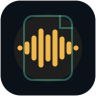

<picture>
  <source media="(max-width: 600px) and (prefers-color-scheme: dark)" srcset="assets/hero/hero-mobile-dark.svg">
  <source media="(max-width: 600px)" srcset="assets/hero/hero-mobile-light.svg">
  <source media="(prefers-color-scheme: dark)" srcset="assets/hero/hero-desktop-dark.svg">
  
</picture>

 

 &nbsp; 

<code>01 / ABOUT</code>

## A builder's mindset

I'm Nest — an engineer who likes turning rough ideas into working systems.

My work sits where **AI**, **computer vision**, **Android**, **Windows**, and **automation** meet. I'm most interested in tools that run close to the user: local models, real-time vision, and software that removes a step from the day.

- **AI systems** — LLM apps, agents, RAG, local inference
- **Vision** — pose estimation, activity recognition, real-time pipelines
- **Products** — Android, Windows, web, and the glue between them

Right now I'm building **SonicBrief**, a local-first transcription workspace, and exploring how agents can automate real workflows without giving up privacy.

<code>02 / SELECTED WORK</code>

## Things I've shipped

###  [SonicBrief](https://github.com/nestchao/SonicBrief) 

**Video and audio → timestamped transcripts, clean summaries.**
Local Whisper on Windows, a standalone Android app, a Chrome extension, and an MCP server for AI agents. No accounts, no cloud uploads, no per-minute bills.

`Kotlin` · `Compose` · `Tauri` · `Whisper` · `MCP`

###  [Hotspot Bypass VPN](https://github.com/nestchao/Hotspot-Bypass-VPN-Unlimited-Hotspot) 

**Share mobile data with Windows and Android — no root required.**
Wi-Fi Direct, SOCKS5, and tun2socks combine into a low-latency, no-root tethering workflow.

`Kotlin` · `Python` · `Android` · `Windows` · `Networking`

###  [AI Studio Bridge](https://github.com/nestchao/ai-studio-bridge) 

**A thread-safe Python bridge to Google AI Studio and Gemini.**
Automates prompting, file extraction, and model workflows through Playwright, wrapped in a clean API for scripts and agents.

`Python` · `Playwright` · `Gemini` · `Automation`

###  [Malaysia Sign Language](https://github.com/nestchao/malaysia-sign-language)

**Real-time Malaysian Sign Language recognition.**
A computer-vision pipeline built with MediaPipe and machine learning for pose tracking and gesture classification.

`Python` · `MediaPipe` · `Machine Learning` · `Computer Vision`

<strong>More things I've built</strong>

 

- **[Synapse Flow](https://github.com/nestchao/Synapse-Flow)** — an autonomous AI study hub and code workspace for notes, exam prep, and repository sync.
- **[Code Context Aggregator](https://github.com/nestchao/Code-Context-Aggregator)** — a visual file-tree tool that packages the right code context for LLMs, with token-aware splitting.
- **[XiaobaoYingYuan APK](https://github.com/nestchao/XiaobaoYingYuan_APK)** — a Jetpack Compose VOD client with MVVM and a robust scraping engine.

[All repositories →](https://github.com/nestchao?tab=repositories)

<code>03 / TOOLKIT</code>

## Tools I reach for

  

- **Build** — Kotlin · Python · TypeScript · Java · C++
- **AI / Vision** — PyTorch · OpenCV · MediaPipe · Whisper · Gemini
- **Ship** — Android · Jetpack Compose · Tauri · FastAPI · Next.js · Docker
- **Exploring** — local inference · agent tooling · Rust

<code>04 / SIGNAL</code>

## A live signal

  <picture>
    <source media="(max-width: 600px) and (prefers-color-scheme: dark)" srcset="assets/stats/stats-mobile-dark.svg">
    <source media="(max-width: 600px)" srcset="assets/stats/stats-mobile-light.svg">
    <source media="(prefers-color-scheme: dark)" srcset="assets/stats/stats-desktop-dark.svg">
    
  </picture>

Pulled from the GitHub API and refreshed daily by <a href="https://github.com/nestchao/nestchao/blob/main/.github/workflows/stats.yml">this workflow</a>.

<code>05 / ELSEWHERE</code>

## Find me elsewhere

- **Portfolio** — [nestchao.github.io](https://nestchao.github.io)
- **SonicBrief** — [live app](https://nestchao.github.io/SonicBrief/)
- **Repositories** — [github.com/nestchao](https://github.com/nestchao?tab=repositories)

Have an interesting problem in AI systems, computer vision, or developer tools? I'm always up for a good conversation.

Easter egg — the contribution snake

  <picture>
    <source media="(prefers-color-scheme: dark)" srcset="https://raw.githubusercontent.com/nestchao/nestchao/output/github-contribution-grid-snake-dark.svg">
    <source media="(prefers-color-scheme: light)" srcset="https://raw.githubusercontent.com/nestchao/nestchao/output/github-contribution-grid-snake.svg">
    
  </picture>

  Always building. Always learning.

